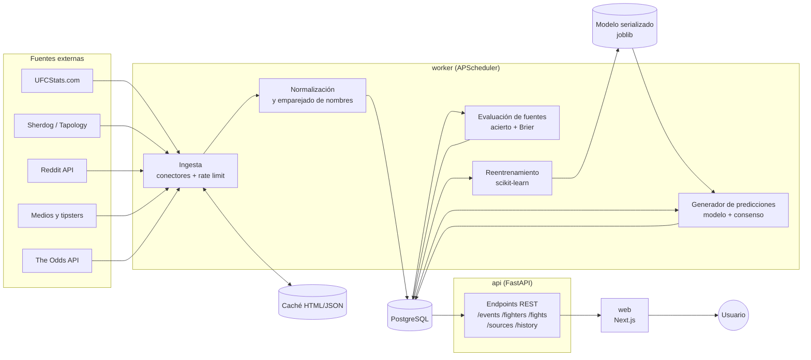

# Fase 1 · Arquitectura de UFC Predictor

Aplicación web que predice peleas de la UFC combinando un modelo estadístico propio con predicciones externas ponderadas por su historial.

> Aviso que mostrará la web: las predicciones son informativas y no garantizan resultados.

## 1. Visión general

Cinco bloques, todos en Docker Compose:

| Bloque | Tecnología | Qué hace |
|---|---|---|
| `web` | Next.js + TypeScript + Tailwind | Interfaz. Solo habla con la API. |
| `api` | FastAPI | API REST. Lee de la base de datos y sirve predicciones ya calculadas. |
| `worker` | Python + APScheduler | Tareas programadas: ingesta, evaluación de fuentes, reentrenamiento, predicción. |
| `db` | PostgreSQL 16 | Fuente única de verdad. |
| `cache` | Volumen con HTML/JSON crudo | Caché de páginas descargadas. Evita repetir peticiones. |

`api` y `worker` comparten el mismo paquete Python (`backend/app`). Cambia solo el punto de entrada. Así no se duplica código de modelos ni de acceso a datos.

Decisión clave: **la API no hace scraping ni entrena nunca**. Todo lo lento va en el `worker`. La API solo lee. Así las peticiones de la web responden rápido y un fallo de una fuente externa no tumba la web.

## 2. Diagrama de componentes



## 3. Flujo de datos

1. **Ingesta**. Cada fuente tiene un conector con la misma interfaz: `fetch()` descarga (respetando rate limit y caché), `parse()` extrae datos, `save()` escribe en la base de datos.
2. **Normalización**. Los nombres cambian entre fuentes ("Alex Pereira" / "Alex Poatan Pereira"). Se emparejan contra el peleador de UFCStats, que es la referencia. Si la similitud es dudosa, se marca para revisión manual en vez de adivinar.
3. **Predicciones externas**. Se guardan con fuente, pelea, ganador, confianza (0-1) y fecha. Si la fuente no da confianza, se usa un valor por defecto configurable.
4. **Tras cada evento**. Se cargan los resultados reales. Se evalúa cada predicción y se recalculan acierto y Brier score por fuente.
5. **Reentrenamiento**. Semanal o tras cada evento. Solo se acepta el modelo nuevo si mejora en validación al actual.
6. **Predicción final**. Para cada pelea próxima se calcula y se guarda con su desglose.

### Combinación de la predicción final

```
p_modelo   = probabilidad del modelo propio de que gane A
p_fuentes  = media ponderada de las fuentes (peso = precisión reciente,
             solo fuentes con >= N predicciones evaluadas)
p_mercado  = probabilidad implícita de las cuotas, sin margen de la casa

p_final = w1·p_modelo + w2·p_fuentes + w3·p_mercado
```

Los pesos `w1, w2, w3` se ajustan en el backtesting (fase 5). Si una pelea no tiene fuentes suficientes, su peso se reparte entre el resto. La web muestra siempre los tres componentes y un intervalo de incertidumbre.

Nota: las cuotas entran como componente separado y no como variable del modelo. Así se ve si el modelo aporta algo frente al mercado. Lo validaremos en la fase 5.

## 4. Tareas programadas

| Tarea | Frecuencia | Descripción |
|---|---|---|
| `sync_events` | Diaria | Próximos eventos y carteleras (UFCStats). |
| `sync_fighters` | Diaria, solo peleadores con pelea próxima | Ficha y estadísticas. |
| `sync_odds` | Cada 6 h en semana de evento | Cuotas. Ajustado al cupo gratuito de la API. |
| `sync_external_predictions` | Diaria en semana de evento | Reddit y medios. |
| `sync_results` | Día siguiente al evento | Resultados reales. |
| `evaluate_sources` | Tras `sync_results` | Acierto y Brier por fuente. |
| `retrain_model` | Semanal | Reentrena y compara con el modelo actual. |
| `predict_upcoming` | Tras cualquier sync | Recalcula predicciones finales. |

También se pueden lanzar a mano: `docker compose run worker python -m app.jobs sync_events`.

## 5. Estructura de carpetas

```
ufc-predictor/
├── docker-compose.yml
├── .env.example            # claves (ODDS_API_KEY, REDDIT_CLIENT_ID...)
├── backend/
│   ├── app/
│   │   ├── main.py         # arranque FastAPI
│   │   ├── worker.py       # arranque del planificador
│   │   ├── config.py
│   │   ├── db/             # modelos SQLAlchemy y migraciones Alembic
│   │   ├── api/            # routers REST
│   │   ├── ingestion/      # un conector por fuente + http con rate limit
│   │   ├── scoring/        # evaluación de fuentes
│   │   ├── ml/             # features, entrenamiento, backtesting
│   │   └── jobs/           # tareas programadas
│   └── tests/
├── frontend/
│   ├── app/                # rutas Next.js (App Router)
│   ├── components/
│   └── lib/api.ts          # cliente tipado de la API
└── docs/
```

## 6. Fuentes: estado legal y técnico

No pude descargar los `robots.txt` desde mi entorno (red restringida). Hay que comprobarlos desde tu máquina antes de la fase 3. Lo que sé, a verificar:

| Fuente | Acceso | Plan |
|---|---|---|
| UFCStats.com | Sin API. HTML estático, sencillo. | Scraping con 1 petición cada 2-3 s, caché en disco, User-Agent identificable. Fuente principal. |
| The Odds API | API oficial con clave. Plan gratuito con cupo mensual limitado. | Usar API. Pocas llamadas y caché. |
| Reddit | API oficial con OAuth. Términos restrictivos para uso de datos. | Usar API, nunca scraping. Extraer picks de los hilos de predicciones de cada evento. |
| Tapology | Sus términos prohíben acceso automatizado, según recuerdo. | Excluir salvo que los términos lo permitan. |
| Sherdog | Términos restrictivos, según recuerdo. | Opcional. Solo si robots.txt y términos lo permiten. UFCStats ya cubre casi todo. |
| Medios y tipsters | Variable. | Empezar con entrada manual (CSV o formulario admin). Automatizar fuente a fuente tras revisar sus términos. |

Todo el tráfico saliente pasa por un único cliente HTTP con rate limit por dominio, reintentos con espera y caché. Un conector nuevo no puede saltárselo.

## 7. Riesgos

- **Pocos datos de fuentes externas**. Las fuentes tardarán varios eventos en acumular N predicciones evaluadas. Hasta entonces pesan cero y manda el modelo.
- **Fuga de datos en el backtesting**. Las estadísticas de cada peleador deben calcularse solo con peleas anteriores a la fecha de la pelea. Es el error más común en este tipo de proyecto.
- **Cambios en el HTML** de UFCStats. Los parsers tendrán tests con páginas guardadas.
- **Emparejado de nombres** entre fuentes. Se resuelve con tabla de alias.
